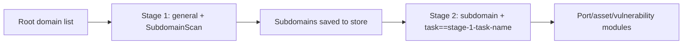

---

## name: scopesentry-mcp
description: Manage a security scanning platform (projects, tasks, templates, assets, nodes) through ScopeSentry MCP. Use when the user mentions ScopeSentry, MCP, API keys, scan tasks, or asset queries.

# ScopeSentry MCP User Guide

For users with a **deployed ScopeSentry instance**. Connect through Cursor (or another MCP client); no local source code is required.

## 1. Prerequisites

### 1.1 Verify Service Availability

- Default web interface: `http://<host>`
- MCP endpoint: `http://<host>/mcp` (when using a reverse proxy or frontend proxy, use the actual `/mcp` address)

### 1.2 Create an API Key

1. Sign in to the ScopeSentry web interface in a browser
2. Open the **API Key** management page and create a key (or use an administrator-provided endpoint)
3. Save the returned `ssk_...` string (**shown only once**)

### 1.3 Configure Cursor MCP

Cursor → Settings → MCP → Add Server:

```json
{
  "mcpServers": {
    "scopesentry": {
      "url": "http://<your-host>:8082/mcp",
      "headers": {
        "X-API-Key": "ssk_your_key"
      }
    }
  }
}
```

Alternatively, use `Authorization: Bearer ssk_your_key`.

After configuration, restart MCP or reload Cursor and confirm that tools such as `list_projects` and `list_assets` appear.

---

## 2. Tool Overview


| Tool | Purpose |
| ---------------------- | ----------------- |
| `list_projects` | Project tree grouped by tags (including project IDs) |
| `list_projects_data` | Paginated project list, searchable by name |
| `get_project` | Project details |
| `create_project` | Create a project |
| `list_tasks` | Scan task list |
| `get_task` | Task details |
| `list_scan_templates` | Scan template list |
| `get_scan_template` | Template details |
| `list_plugin_modules` | Scan pipeline module names |
| `list_plugins` | Available plugins (including hashes and default parameters) |
| `create_scan_template` | Create a scan template |
| `create_scan_task` | Create a scan task |
| `list_assets` | Query asset types (paginated lists) |
| `count_assets` | Count assets (`/api/assets/common/total`) |
| `get_asset_detail` | Asset or vulnerability details |
| `add_asset_tag` | Add a tag to an asset |
| `list_nodes` | Scan node list |


The MCP tool descriptions (schemas) define tool parameters. `list_assets` / `count_assets` share search and filter syntax; read the `list_assets` description before querying assets.

Use `count_assets` for total counts (the web pagination total endpoint), instead of repeatedly paging through `list_assets` to count records.

---

## 3. Common Workflows

### 3.1 Query Assets by Project

When the user or context **already specifies a project**, prefer `filter.project` to narrow the scope and avoid slow responses from excessive cross-project data. A project filter is optional if no project is specified.

1. Use `list_projects` or `list_projects_data` to obtain the target project's **ObjectID** (`id` / `children[].value`)
2. Pass `filter.project` to `list_assets` (**must be an ID, not the project's display name**)

```json
{
  "asset_type": "asset",
  "pageIndex": 1,
  "pageSize": 20,
  "search": "domain=^example.com",
  "filter": {
    "project": ["<project-ObjectID>"]
  }
}
```

### 3.2 Create a Scan Task

1. Use `list_nodes` to obtain online node names
2. Use `list_scan_templates` or `create_scan_template` to obtain the template **ObjectID**
3. `create_scan_task`: `name` and `node` are required; `template` takes the template ID, not its name

**Target source `targetSource` (same as the web interface):**

| targetSource | Description | Required parameters |
| --- | --- | --- |
| `general` | Enter targets directly | `target` |
| `project` | Read targets from projects | `project` (array of project ObjectIDs) |
| `asset` | Search the web asset store | `search`; optional `project`, `filter`, `targetNumber` |
| `RootDomain` | Search the root domain store | `search`; optional `project`, `filter`, `targetNumber` |
| `subdomain` | Search the subdomain store | `search`; optional `project`, `filter`, `targetNumber` |
| `UrlScan` | Search URL scan results | `search`; optional `project`, `filter`, `targetNumber` |
| `*Source` (e.g. `subdomainSource`) | Create from selected/searched assets on an asset page | Use `search` with `targetTp=search`; use `targetIds` with `targetTp=select` |

**Example — Scan root domains directly:**

```json
{
  "name": "example-subdomain-discovery",
  "node": ["node-1"],
  "template": "<template-ObjectID>",
  "targetSource": "general",
  "target": "example.com\nfoo.com",
  "project": ["<project-ObjectID>"]
}
```

**Example — Continue scanning from the subdomain store (filtering by the previous task name):**

```json
{
  "name": "example-ports-and-vulnerabilities",
  "node": ["node-1"],
  "template": "<follow-up-template-ObjectID>",
  "targetSource": "subdomain",
  "search": "task==\"example-subdomain-discovery\"",
  "project": ["<project-ObjectID>"]
}
```

### 3.3 Complete Root Domain Reconnaissance (Two Stages Recommended)

When the input is **root domains** and **complete reconnaissance** is required, use two scans instead of running the entire pipeline at once.

**Reason:** Distributed tasks are assigned per **individual target**. When a node receives a root domain, the subdomains discovered on that node also run subsequent modules on the same node, potentially causing uneven load, slow execution, and errors.

**Best practice:**

1. **Stage 1 — Subdomain discovery only**
   - `targetSource`: `general`
   - `target`: all root domains (one per line)
   - Template: enable only `SubdomainScan` and `SubdomainSecurity` (subdomain scanning + subdomain takeover)
   - Use `get_task` to wait for completion

2. **Stage 2 — Subsequent modules**
   - `targetSource`: `subdomain`
   - `search`: `task=="<stage-1-task-name>"` (exact task-name match)
   - Optionally narrow the scope with `project`
   - Template: port scanning, asset mapping, vulnerability scanning, etc. (SubdomainScan may be omitted)
   - Subdomains are distributed to nodes as independent targets, improving parallel efficiency

Alternatively, filter the web interface's Subdomain asset page by task name and use "Create task from subdomains" for the same result.



### 3.4 Create a Scan Template

1. `list_plugin_modules` → module name list
2. `list_plugins` (optionally filter by `module`) → each plugin's `hash` and default `parameter`
3. `create_scan_template`: use `modules` to specify "module → array of plugin hashes"

---

## 4. Asset Queries (`list_assets` / `count_assets`)

`count_assets` and `list_assets` use the same `asset_type`, `search`, and `filter`. The former returns `{ "total": N }`, corresponding to `/api/assets/common/total` in the web interface.

```json
{
  "asset_type": "subdomain",
  "search": "task==\"some-task-name\"",
  "filter": {"project": ["<project-ObjectID>"]}
}
```

**Performance guidance (for both `list_assets` / `count_assets`):** When a project is known, prefer `filter.project` to narrow the scope. In `search`, prefer exact `==` or `^` prefix matches on indexed fields (see [4.3](#43-search-expressions)) to avoid slow, broad `=` fuzzy searches. A project filter is optional without project context.

See the [4.4](#44-exact-filtering-with-filter) table for types supporting `filter.project`.

### 4.1 Asset Types: `asset_type`

`asset`, `RootDomain`, `subdomain`, `app`, `mp`, `UrlScan`, `SensitiveResult`, `DirScanResult`, `crawler`, `vulnerability`, `PageMonitoring`, `IPAsset`, `SubdomainTakerResult`

Alias examples: `web`→asset, `vuln`→vulnerability, `ip`→IPAsset, `url`→UrlScan

### 4.2 Parameters


| Parameter | Description |
| ------------------------ | --------------------------------------- |
| `pageIndex` / `pageSize` | Pagination, default 1 / 20 |
| `search` | Search expression (see below) |
| `filter` | Exact-filter JSON (see below) |
| `sort` | Only UrlScan and DirScanResult support sorting by `length` |
| `sid` | SensitiveResult only: sensitive rule name |


`search` and `filter` **can be combined**.

### 4.3 search Expressions

Custom DSL (**not SQL**):


| Operator | Meaning | Index use | Example |
| ---- | ---- | ---- | --------------------------- |
| `=` | Fuzzy match (regex) | No | `domain=example` |
| `==` | Exact equality | **Yes** | `port==443` |
| `!=` | Exclude | — | `port!="80"` |
| `&&` | AND | — | `domain==example.com && port==443` |
| `||` | OR | — | `title=admin || body=login` |


**Indexes and operators:** Fields such as `domain`, `ip`, `port`, and `title` are indexed, but indexes are used only for **exact `==` equality** or **prefix matching with a value starting with `^`** (e.g. `domain=^example.com`). **`=` becomes a fuzzy regex match and cannot use an index**, which can be slow on large datasets.

**Search fields shared by all types:** `tag`, `task` (task name), `rootDomain`

**Do not put project in search** (it is ineffective or errors when combined with `&&`). Use `filter.project` to filter projects.

**Common search fields by type:**


| asset_type | Fields |
| -------------------- | ----------------------------------------------------------------------------------- |
| asset                | domain, ip, port, service, app, title, statuscode, icon, banner, type, body, header |
| RootDomain           | domain, icp, company                                                                |
| subdomain            | domain, ip, type, value                                                             |
| app                  | name, icp, company, category, description, url, apk                                 |
| mp                   | name, icp, company, category, description, url                                      |
| UrlScan              | url, input, source, resultId, type                                                  |
| SensitiveResult      | url, sname, body, info, md5                                                         |
| DirScanResult        | url, statuscode, redirect, length                                                   |
| vulnerability        | url, vulname, matched, request, response, level                                     |
| crawler              | url, method, body, resultId                                                         |
| PageMonitoring       | url, hash, diff, response                                                           |
| IPAsset              | ip, domain, port, service, webServer, app                                           |
| SubdomainTakerResult | domain, value, type, response                                                       |


**Search examples:**

- `domain==www.example.com && port==443` (exact equality, indexed)
- `domain=^example.com` (prefix match, indexed)
- `ip==192.168.1.1`
- `task=="some-task-name"`
- `level==high` (vulnerability)
- `statuscode==200` (DirScanResult)

Use `=` only when fuzzy containment is needed, e.g. `title=admin` (not indexed; combine with project or other constraints to narrow the scope).

### 4.4 Exact Filtering with filter

JSON object: multiple values for the same key use **OR**; different keys use **AND**.

**Prefer `project` when a project is known:** If the user or context specifies a project and asset_type supports `project`, include it to narrow the scope. It is optional when no project is known.


| filter key | Meaning | Values |
| ------------ | -------- | -------------------------------------------------------- |
| `project` | Owning project | **ObjectID**, obtained with `list_projects` / `list_projects_data` |
| `task` | Source task | **Task name**, from `list_tasks`'s `name` |
| `port` | Port | e.g. `"443"` |
| `service` | Service/protocol | e.g. `"https"` |
| `app` | Application fingerprint | e.g. `"Nginx"` |
| `icon` | Icon hash | |
| `statuscode` | HTTP status code | Primarily for asset |
| `status` | Status | UrlScan/DirScan HTTP code; vulnerability/sensitive-information handling status |
| `level` | Vulnerability severity | critical / high / medium / low / info |
| `type` | Type | e.g. subdomain record types A, CNAME |
| `color` | Sensitive rule color | SensitiveResult |
| `sname` | Sensitive rule name | SensitiveResult |
| `tags` | Tags | |


**Available filter keys by type:**


| asset_type                            | filter key                                                      |
| ------------------------------------- | --------------------------------------------------------------- |
| asset                                 | project, port, service, app, icon, statuscode, type, task, tags |
| RootDomain                            | project, tags                                                   |
| subdomain                             | project, type, task, tags                                       |
| app / mp                              | project, tags                                                   |
| UrlScan                               | status, tags                                                    |
| DirScanResult                         | status, tags                                                    |
| SensitiveResult                       | status, color, sname, tags                                      |
| crawler                               | project, task, tags                                             |
| vulnerability                         | project, level, status, task, tags                              |
| PageMonitoring / SubdomainTakerResult | tags                                                            |
| IPAsset                               | project, port, service, app                                     |


**Filter example:**

```json
{"project": ["<project-ObjectID>"], "port": ["443"]}
```

**Combined query example:**

```json
{
  "asset_type": "asset",
  "search": "domain=^baidu && port==443",
  "filter": {"project": ["<project-ObjectID>"]},
  "pageIndex": 1,
  "pageSize": 10
}
```

**Notes:**

- Prefer `filter.project` when a project is known and the type supports it; optional without project context
- Do not use a project's display name in `filter.project`
- Use `==` for known values and `^` for prefixes; avoid excessive `=` fuzzy matches on large tables
- Use `filter.status` for UrlScan HTTP status; DirScanResult supports `statuscode==200` in search
- For SensitiveResult rule names, use `sname=rule-name` in `search`, or `filter.sname`

### 4.5 Sorting with sort

Supported only by **UrlScan** and **DirScanResult**:

```json
{"length": "ascending"}
```

Other types ignore `sort` and use the default time-based ordering.

---

## 5. Scan Template Module Names

`TargetHandler`, `SubdomainScan`, `SubdomainSecurity`, `PortScanPreparation`, `PortScan`, `PortFingerprint`, `AssetMapping`, `AssetHandle`, `URLScan`, `WebCrawler`, `URLSecurity`, `DirScan`, `VulnerabilityScan`, `PassiveScan`

---

## 6. Troubleshooting


| Symptom | Resolution |
| --------- | -------------------------------------------------- |
| No MCP tools | Check URL, API key, and whether ScopeSentry is running |
| 401 / 403 | Recreate or replace the API key |
| Assets not found | Verify that `filter.project` is an ObjectID; do not put project in search |
| Template/task creation fails | `template` must be a template ObjectID; `node` must contain online node names |
| Query is slow/stuck | Add `filter.project` when a project is known; use `==` or `^` prefixes on indexed search fields and fewer `=` matches; reduce `pageSize` |


---

